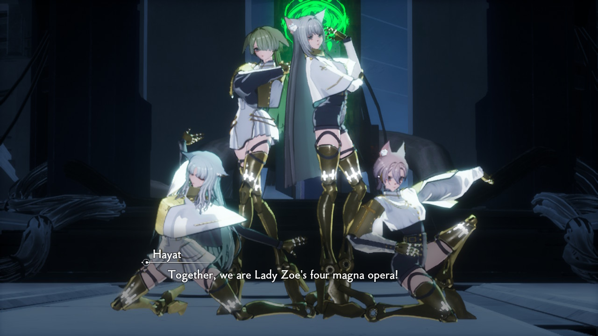

+++
title =  "Ai/Robots in Fiction ver. 7 -- CRYMACHINA"
date = 2025-04-04T13:34:54+02:00
draft = false
+++

## Preface
I was in Japan during the winter break, visiting family like usual. I tend to go to BookOff to buy used goods (thrifting clothes mostly) and was in the game section when a certain piece caught my eye. The game's package had beautiful art with its composition - surely it's a well-known game I thought. To my surprise, this game isn't very known and has a relatively low Metacritic score (I literally don't trust any of these dog-ass video game critics especially IGN) and meh user ratings (I trust these reviews though). So, I just put it back in the aisle and went with my day.

Zoom back to the present, after completing Drakengard 3 with my friend, he found a new game to play that was said to match Drakengard's storytelling - CryStar. And while the game is rough on its edges, it had a wonderful soundtrack and shocking turns, so when I tried to search for similar games to that, I was shocked to see what I found. After months forgetting about it and playing other games due to Yoko Taro's ever-casting presence, I came back full circle, through sheer coincidence, back to that game I found fifty-percent off at the aisle at BookOff. That game was CRYMACHINA.

*I mean just look at this wallpaper art.*

At that point, I felt like it was fate or a calling. Maybe this was what Griffith felt when he started laughing upon noticing the behelit return to him at his lowest point (although, I wasn't going to cause the Eclipse or anything). I'll come back to talk about Berserk later...

---

## Thoughts

First and foremost, the world behind CRYMACHINA determines a large part of its unique identity among sci-fi. Humanity has been wiped extinct after a catastrophic concotion of a deadly disease and rampaging wars. Before the demise of humanity however, a group of researchers worked on the EDEN project -- a goal to launch a circular spaceship, EDEN, with billions of records of humanity alongside with nine 'sentient' super AI/robots, with the goal of reviving human life again. There exists no biological trace on EDEN, though it was never the plan to restart human life through biological means. Rather, the researchers decide to recreate humans through tasking these AI to develop and iteratively upgrade mechanical bodies, engrained with human personalities and memories recreated through algorithmic means. Such entities are called E.V.E's, but once they gain collect enough ExP through exposure to this world (it's a game, after all), they will reach the status of a 'human.'

  
*Four-person group, Trinity. JOJO reference???*

### What defines humanity? 
Significantly, the status of 'human' is taken seriously by the nine AI/robots, as part of their main responsibility contains withholding and abiding by [Isaac Asimov's famous three laws of robotics](https://en.wikipedia.org/wiki/Three_Laws_of_Robotics):

> 1. A robot may not injure a human being or, through inaction, allow a human being to come to harm.
> 2. A robot must obey the orders given it by human beings except where such orders would conflict with the First Law.
> 3. A robot must protect its own existence as long as such protection does not conflict with the First or Second Law.

As such, the goal for the EDEN project is to restart humanity, and once accomplished, the nine AI/robots will just fade away after human orders. Yet, throughout the narrative, we witness unintended behavior that disregard this absolute law. Some of the nine take part in sibling-ship, as if they were a blood family, despite not within their responsibilities to maintain such relationships with others. Furthermore, such robots develop unique personalities and emotions, crying during intense moments or holding favoritism/spite for specific individuals. Lastly, how strict Asimov's three laws apply is unknown and somewhat hazy - critically, a certain human's orders were completely rejected. In this sense, the game posits that *humanity is hard to define.*

### Inspirations and Connections
I'd like to note a few things mentioned during an [interview with the producer](https://nisamerica.com/crymachina/special) behind the game, Fuyuki Hayashi, specifically, what his inspirations were. Mainly, the producer talks about how the manga BLAME! and Nausicaä of the Valley of the Wind heavily inspired his work. I've yet to read Nausicaä, but since I know BLAME!, I want to point the connections I found fun.

#### BLAME! and Stairs
From my understanding, it looks like the main connection to BLAME! is the architectural design found within EDEN. Various areas are full of impending towers that look down on you, and there's little light coming from the top. It's overall a grim world, much like what we see in BLAME!. It doesn't contain any of the romance found in similar structures like [Kowloon](https://en.wikipedia.org/wiki/Kowloon_Walled_City). There are no low-frame shots of a couple's long motorcycle ride, nor certain martial artists falling down tons of glass and lights -  it's entirely grim instead. The air seems dense and fog-like, and the eerie-color palette of some areas only creates a sense of sonder. You're all alone.

On another note, the odd feeling reminded me of Berserk, particularly the staircase-dimension. There births new feelings now - one feels lost and trapped, almost as if they're running out of time. While there's no exact architecture akin to it, after much progression through each mission, at the end you just ask yourself: "Is the fight even worth it?" Below is a picture of [*Relativity* by M.C. Escher](https://en.wikipedia.org/wiki/Relativity_%28M._C._Escher%29). This artpiece has created mass impact onto media, notably onto the staircase-dimension of Berserk (and istg in the original FF7, the [Temple of the Ancients](https://finalfantasy.fandom.com/wiki/Temple_of_the_Ancients) is inspired by it too). 

*Just overall evil*

#### NieR: Automata
Given that my [first post](../../2024/nier/) was about NieR, I think it's fitting to bring the topic back to NieR. Contextually, CRYMACHINA and NieR are really similar. Action RPGs, multiple endings (technically, albeit this is more true in CryStar than CRYMACHINA), and death robots. I believe that the main difference between the two is how humanity is defined and comprehended by robots.

In NieR, the androids and robots worship humans. They want to live similar lives and partake the same actions whether that's attending amusement parks, having fist fights in colosseums, or reproducing sexually. The humans have long been wiped out, and that's exactly what motivates such entities to imitate their beahvior - *because humans are their gods.*

On the other hand, in CRYMACHINA, the player is ultimately forced to eradicate biological human life in exchange for their human-like emotions and personalities. These robots do not worship humans but do act rather human themselves, practically replacing humanity with their mechanical race instead. The protagonists, in a sense, argue that the *essence of humanity triumphs in priority over the existence of it.*

Conclusively, it's interesting how different characterizations for the same genre can create similar onlooks of humanity and particularly the robots that replace them. The robots in NieR fight for a non-existent humanity, to preserve their behavior and imitate their actions. The robots in CRYMACHINA fight for the essence of humanity, to preserve their personalities and emotions. Overall, both works depict robots fighting for the metaphysical human instead of the physical. For such robots to exist in any world, must they achieve some sort of consciousness? Regardless, I'd wish not for such kind of robots to be in existence, especially death bots. It'd be ideal if we can limit such creations like Metal Gear strictly to sci-fi and not real life.