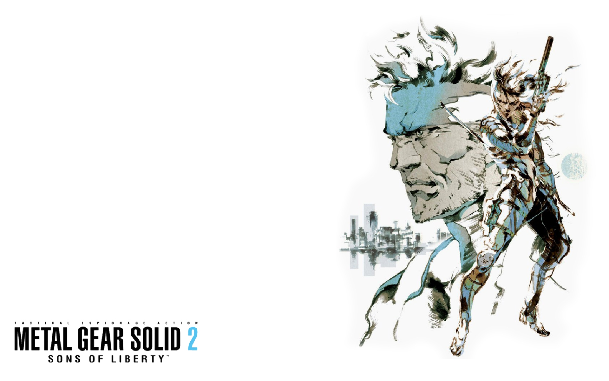

+++
title =  "Ai/Robots in Fiction ver. 8 -- Metal Gear Solid 2"
date = 2025-05-13T13:34:54+02:00
draft = false
+++

The *Metal Gear Solid* series is a cult favorite for many reasons, but to give a sentence to sell you on the series, it's an over-the-top serious anti-war story with tons of goofy boss fights and funny characters. While there's tons of comedy and fun gameplay, the overall messages found within the games is profound and to me, I think *Metal Gear Solid 2* is where its significance kickstarts. I'd like to explain the brilliance of this specific piece here.

*Cover art by Yoji Shinkawa, the goat*

Even before I get into my opinions, I think this [video](https://www.youtube.com/watch?v=jIYBod0ge3Y) pretty much captures the majority of my ideas - it talks about the last codec conversation that partakes in the climax of the game. So, I'd first highly recommend that you'd go watch it to get the general gist. I have some more points to add from the technical side.

## Deepfakes
With every rise in technology, there's bound to be a wrongful application; deepfakes are one such example. Traditionally, these are the usage of computer vision techniques to override the appearance of a person in a photo/video to look like someone else. Consequently, creators of deepfakes intend to publish decepting videos showcasing [certain politicians spewing controversial views](https://video.ucdavis.edu/media/Deep+Fake+of+Barack+Obama/1_6zmvebuf) or [unconsenting individuals starring within pornography](https://www.bbc.com/news/articles/ckvgezk74kgo), to name a few. More recently, audio deepfakes have become more popular, especially within meme culture. There are tons of videos depicting traditionally rival politicians - [Obama, Trump, and Biden](https://www.youtube.com/playlist?list=PLQMt0saTRJ0LDkIdKgbJLbYlqcEtBHCfy) - play games and banter together, and [Family Guy/Simpsons](https://www.youtube.com/watch?v=-EX9HWvtW0Y) characters singing covers of popular songs. Often, the motiviations behind individual creators can range from pure comedy, [rage-baiting](https://www.bbc.com/news/articles/ckvgezk74kgo), or cyber bullying, but I'd suspect there's interest in various organizations to weaponize deepfakes for the purpose of creating mass, collective hysteria through *Misinformation*.

## Misinformation
Misinformation is the publication of false information, with or without intention to decept people. I remember growing up, I've often been told by my teachers not to use Wikipedia as a source; it's because many Wikipedia articles are not peer reviewed rigorously enough to be up-to-date and always accurate (lol). Misinformation is similar. There exist tons of sources online that/who may state certain things which are incorrect or misleading. There's nothing inherently wrong with that, as these are just easy-to-grab sources, not peer-reviewed material (I'd bet some things I state aren't totally accurate too). However, people often listen to these sources blindly, without deciding to fact-check for the truth. We even saw recently how many [Redditors have been somewhat "decepted" in believing users were human, and not AI-generated chatbots](https://www.washingtonpost.com/technology/2025/04/30/reddit-ai-bot-university-zurich/). Though, it's crucial to not [victim blame](https://en.wikipedia.org/wiki/Victim_blaming), rather, we must create safety mechanisms to prevent such problems. But how exactly can we create these safety mechanisms? With each leap in technology, misinformation (and deepfakes) may not only become harder to detect, but also become produced exponentially more. In such a case, preventative measures will always be one-step behind, scurrying to find novel methods to detect and search for deception. With all this scurrying, however, who knows when such misinformation may lead to truly destructive behavior onto the real world, instead of just the digital world? Metal Gear Solid 2's villain proposes a solution, but you may not like it.

## Metal Gear Solid 2's villain's proposed solution
Control the flow of ALL information. That is the solution MGS2's secret villain proposes. Interestingly, this villain is GW, an AI made to help steer the success of humanity towards greatness. Though, it's too focused on a particular part of the mission rather than the whole (kinda like the spaceship controller seen in Wall-E). GW aims to takeover all flow of information and show only material necessary and factual to people, at the cost of the freedoms and fluidity birthed from the digital era. While this rigidity is bordeline totalitarian, GW brings about multiple truths. Humans like to produce stuff, to the point of it being practically bloatful, conclusively leading to tons of people producing absolute garbage which subsequently gets ingested by the public. GW argues that humanity itself will catalyze the extinction of the human race, that we are too willing to live within this garbage that hurts us. We have and currently live in a cesspool, hence why we let ourselves never see the light and the heavens; GW believes that strict regulation of information flow will birth the next enlightenment and enrich all of society. We will lose freedom, but it's a sacrifice we need to continue our race.

## Snake's solution
Such claims hold truth, we don't deny that. Though, it all feels like the tiger mom parent nagging/pressuring their child into becoming a doctor. The parent isn't wrong in saying that becoming a doctor is (probably) great and all, that career path earns money and security. They mention this to pressure the child yes, but it's also because in their world view, that's what's best for all of humanity. It's the strict standard they put onto themselves and anyone else. GW, too, has such strict standards that hold some logical truth, but overall don't actually recognize that humans (and by analogy the child) has their own dreams, wishes, beliefs. The apple does not fall too far from the tree? Sure. But it's an apple, not a tree. Let it have it's own life.

So, Snake (the deuteragonist) instead "proposes" a tamer solution: use this age of technology to ensure that people's views get passed on. While he does not directly mention a moderator/regulator of information flow like GW, he believes that through [speech, music, literature and movies](https://en.wikipedia.org/wiki/Victim_blaming), delineating one's emotions and experiences onto the next generation is vital for humanity. While GW's extreme approach of purely factually correct information may provide the continuation of humanity's DNA, Snake's tamer approach prioritizes that the spirit, instead of DNA, is passed on. There's no need for a totalitarian regulator of the internet because the public will at least regulate the view itself. Different circles of ideologies will blossom, co-exist, conjoin, or even clash, inevitably leading to self-regulation of the human spirit. GW, and tiger moms, believe that humans (and children) are too naive and self-destructive without constant interference. Snake, at his heart, believes in the good of the people, and that the freedom and flexibility given as a right to the individuals will work together in unifying a lovely world.